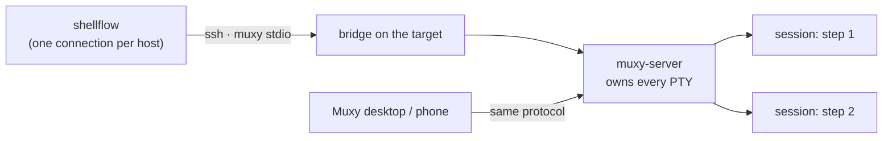

# ShellFlow over Muxy: a native protocol transport

> Status: proposal (not implemented).
> Date: 2026-10-25.
> Scope: run long-lived remote blocks through a `muxy-server` on the target, using
> the muxy wire protocol directly (real frame streaming, one connection per host,
> no per-command `ssh`), while `ssh` stays the default and the fallback.
>
> Evidence base: muxy `2.2.0` / protocol `2` (upstream `muxy-app/muxy` at
> `d1bffca5f218526a9f1f6bc94a2583676f3808b5`, 2026-10-23), read from source and
> measured against `trade` (57.180.173.214) and `api` (46.4.66.214) on
> 2026-10-25; shellflow `0.4.11` on `master`.

---

## 0. Summary

`muxy-server` already solves the two problems a long deploy has: a step must
survive the loss of the operator's connection, and an operator must be able to
watch and kill it from somewhere else. ShellFlow should use that server — but
through its **protocol**, not through the `muxy` CLI.

The CLI costs ~1.5 s of `ssh` per call and exposes only terminal snapshots
(`read-screen`, `history`). A native client keeps **one connection per host for
the whole run** and receives **screen frames as they are produced** (~16 ms
ticks), which is exactly the surface the Muxy desktop app renders.

| | today (`ssh`) | proposed (`muxy` transport) |
|---|---|---|
| Connection | one `ssh` per step | one `ssh` + bridge per **host per run** |
| Output | byte stream, line-oriented | run-length screen frames, assembled into lines |
| stderr separation | yes | **no** — the PTY merges both streams |
| ANSI colour | passed through | not emitted; only per-run style metadata is available |
| Exit code | `ssh` exit status | `SessionEnded{Exited(n)}` |
| Step survives a dropped client | no (SIGHUP) | **yes** (the server owns the session) |
| Cancellation | kill the process group | `EndSession` (the server kills the PTY) |
| Observability | local log only | the step is a terminal in the Muxy app/phone |
| Extra per-step cost | 0 | ~0.2 s (create + attach + file write) |

The design is **opt-in per host, auto-detected, and never silently
re-executes**: `--transport auto` (default) uses muxy where a compatible server
answers and `ssh` everywhere else.

---

## 1. Goals & non-goals

### Goals

- **G1** A remote block can run for as long as `@timeout` allows, unaffected by
  the operator's laptop sleeping or the network dropping.
- **G2** Output is delivered live, in order, exactly once, per host — through the
  existing `Ui::host_line` path, so masking, `--output grouped`, and the audit
  log keep working unchanged.
- **G3** The exit code contract is unchanged: `0` ok, `42` skip (`@only_if`),
  other codes are script failures, transport failures stay distinguishable.
- **G4** No secrets on the target's disk or in the terminal echo.
- **G5** `ssh` remains the reference implementation; a muxy failure never turns a
  green run red when `--transport auto` is in effect.
- **G6** A step that the operator interrupted does not keep running unless they
  asked for it (`--muxy-keep`).

### Non-goals

- Replacing `rsync` for `@copy` (muxy's file API is whole-file JSON, 5 MiB, no
  delta, no excludes, no `--delete`).
- Rendering terminal graphics, clipboard, links, or interactive TUIs.
- Mobile pairing / TLS (`RemoteEndpoint`) — shellflow never pairs a phone.
- Installing muxy on targets, or managing `muxy-server` (start/stop/upgrade).
- Reusing *the operator's* existing muxy sessions; shellflow creates its own and
  never attaches to anything it did not create.

---

## 2. What muxy offers (verified against 2.2.0)

### 2.1 Process model



- The server owns sessions; a client detaching, crashing, or sleeping does not
  end them. A **server** restart or a host reboot does.
- Each session is a login shell in a PTY. Closing the last reference ends it.
- Saved screen and scrollback survive the session (16 MiB budget per session,
  7-day retention by default).

### 2.2 Wire protocol

| Layer | Detail |
|---|---|
| Framing | length + protocol version + channel + message kind; CBOR (minicbor) for messages, postcard for screen rows |
| Channels | channel `0` = control; each attached session gets its own channel |
| Flow control | **one frame in flight per attached session**; a newer frame merges into the waiting one; the client acks each frame |
| Requests | every request has an id and exactly one reply; malformed traffic closes the connection |
| Version | currently `2`; additive changes do not bump it; unknown requests answer `Unsupported` |
| Features | `Feature::TERMINAL_INPUT (1)`, `Feature::SESSION_ENVIRONMENT (2)` — advertised in `HelloReply` |

Frames carry only the rows that changed, plus the cursor and the size. A resize
sends the whole screen. `Row { index, runs: [Run{text, width, style}] }`.

### 2.3 The client surface this design uses

`muxy-client` is the same crate the desktop app and the CLI use. Everything below
is public API today.

| Call | Use |
|---|---|
| `ChildStream::spawn(Command)` | wrap shellflow's **own** `ssh` invocation as a `ByteStream` |
| `Client::connect_bridge(stream, dest, timeout, \|\| BridgeExit)` | consume the `MUXY-STDIO/1` ready line, do the handshake, classify failures |
| `client.server_info()`, `client.features()` | log the version once; gate `SESSION_ENVIRONMENT` |
| `client.events()` | take the single `Receiver<ClientEvent>` |
| `client.create_project_session_with_environment(project, op, dir, size, env)` | create a session (the env is applied to the shell, never written to disk) |
| `client.attach(id, Size)` → `Attachment{channel, grid, …}` | subscribe to the screen |
| `client.write_input(channel, bytes)` | type the bootstrap line |
| `client.ack(channel, seq)` | flow control (must be sent per frame) |
| `client.end_session(id)` / `discard_session(id)` | stop / stop + delete saved output |
| `client.files(FilesRequest{project, action})` | `WriteBytes` the payload, `Delete` it afterwards |
| `client.exec(ExecRequest{argv, stdin, env, cwd, timeout_ms})` | `--check` (`bash -n -s` with the payload on stdin) |
| `client.ping()` | liveness for a connection held across steps |
| `client.request_with_timeout` | (internal) `files` and `exec` already carry their own budgets |

`Client` is `Clone + Send + Sync`; the events receiver is single-consumer, which
is why the design has one pump thread per host.

### 2.4 Measured costs and limits

Measured on 2026-10-25 from this workstation (macOS, 12 ms RTT to `trade`):

| Operation | Cost / limit |
|---|---|
| `ssh host muxy stdio` + handshake (via `muxy --host`) | **1.4 – 1.9 s** |
| a local server round trip through the CLI | 10 – 15 ms |
| `session create` → session id | ~0.1 s after the connection exists |
| attach + first frame | ~10 ms |
| frame cadence while output is flowing | ~16 ms, merged per ack |
| `exec` wall clock | `timeout_ms` ≤ **300 000**, output ≤ **4 MiB** per stream |
| `input` per write | ≤ **1 MiB** |
| `environment` per session | ≤ 128 vars, ≤ 64 KiB |
| file write/read | ≤ **5 MiB** per file, paths relative to the project root |
| session screen | `cols` ≤ 4096, `rows` ≤ 1024 |
| scrollback | 16 MiB per session, older rows dropped |

The CLI's cost is paid **per call** — create, wait, read, discard — so a step
through the CLI pays ~7 s of pure overhead. The native client pays it once per
host.

### 2.5 Failure taxonomy

`Client::connect_bridge` classifies what went wrong before the handshake:

- bridge never printed `MUXY-STDIO/1` → ssh exited (127 `muxy: not found`,
  255 unreachable / auth refused) with ssh's stderr tail;
- bridge printed an unknown version → `RemoteReason::Incompatible`;
- nothing printed within the ready timeout → `RemoteReason::Timeout`;
- handshake rejected unknown protocol versions → `ClientError::VersionUnsupported`
  → reported as `Incompatible`.

These map cleanly onto shellflow's exit codes (transport = 3, script = 4).

---

## 3. Architecture

### 3.1 Module map

```
crates/shellflow-muxy/          new library crate (unit-testable, mutation-tested)
  src/lib.rs                    public surface: probe, open, run_step, outcome types
  src/connect.rs                ssh command construction + ChildStream + connect_bridge
  src/conn.rs                   the connection actor: pump thread, acks, ping, requests
  src/session.rs               create → attach → bootstrap → stream → outcome → cleanup
  src/lines.rs                  RunGrid → line assembler (pure, property-tested)
  src/payload.rs                Files WriteBytes / Delete, stale sweep, bootstrap text
  src/error.rs                  thiserror types, no strings
bin/shellflow/src/executor/muxy.rs
                                adapter: payload construction, Ui::host_line, outcome map
```

Why a separate crate: `bin/shellflow/src/**` is excluded from `cargo-mutants`
(see `.cargo/mutants.toml`). The line assembler and the outcome mapping are
exactly the logic that must be mutation-covered, so they live in a library crate
with `proptest` properties next to them.

### 3.2 One connection per host

```
tokio task (step N) ──request──▶ mpsc<Request> ──▶ pump thread (std)
                                                    │  Client (clone)
                                                    │  owns events receiver
                                                    │  owns RunGrid per channel
                                                    │  acks every frame
                                                    ▼
                                             broadcast<HostEvent>
                                                    │
tokio task (step N) ◀── lines / ended ──────────────┘
```

- The **pump thread** is the only consumer of `Client::events()`. It applies each
  frame to that channel's `RunGrid`, acks it (`frame.seq`), feeds the line
  assembler, and forwards finished lines to the step's channel.
- Requests (`create`, `attach`, `files`, `end`) are blocking std calls; they run
  on `tokio::task::spawn_blocking`, never on the runtime.
- The connection lives in `MuxyHost` inside the run's `ShellCache`-style map, so
  every step on that host reuses it. `--ssh-reuse` becomes irrelevant for those
  hosts: the connection is already long-lived (and muxy forces
  `ControlMaster=no`, which is the right choice for a connection that must not
  be multiplexed with the operator's own `ssh`).
- A ping every 15 s detects a half-open connection between steps; a failed ping
  drops the client and the next step reconnects.

### 3.3 Step lifecycle

```mermaid
sequenceDiagram
    participant SF as shellflow
    participant SSH as ssh (child)
    participant S as muxy-server
    participant PTY as session (login shell)

    SF->>SSH: ssh -T host 'sh -c "…exec muxy stdio"'
    SSH-->>SF: MUXY-STDIO/1
    SF->>S: Hello{versions:[2]}
    S-->>SF: HelloReply{server, features}
    Note over SF: once per host, per run

    SF->>S: Files WriteBytes(.shellflow/steps/<run>/<step>.sh)
    SF->>S: CreateSession{home project, dir=$cwd, size=200x50, env=@env+@secrets}
    S-->>SF: SessionCreated{id}
    SF->>S: Attach{id, size}
    S-->>SF: Attached{channel, snapshot}
    SF->>PTY: write_input("chmod 700 …; exec bash …/step.sh\r")
    loop every frame
        S-->>SF: Frame{rows, cursor, seq}
        SF->>S: Ack{seq}
        SF->>SF: grid.apply → line assembler → Ui::host_line
    end
    S-->>SF: SessionEnded{id, Exited(n)}
    SF->>S: Detach{channel}, Files Delete(payload)
    SF->>SF: outcome ← n (42 = skipped)
```

Notes:

- One **session per step** — not a long-lived shell shared by steps. That keeps
  today's semantics exactly (each block starts with `set -eu`, its own env, no
  leaked `cd`), and matches decision **D-7** ("explicit state passing instead of
  a long-lived shell") in `docs/design.md`.
- `Detach` leaves the session alive until its program exits; the step has already
  ended by then, so the session is `Ended` and visible in the Muxy app for
  post-mortem inspection, then subject to muxy's own retention.
- `discard_session` (delete the saved output) is used only when the step
  succeeded **and** `@secrets` were in play, so a secret-bearing screen does not
  sit on the target for seven days.

### 3.4 Why not `exec`?

`ExecRequest` is attractive — stdin, env, cwd, exact stdout/stderr, exact exit
code — but:

- it is a request/reply with **no durability**: if the connection drops, the
  reply is lost and the run cannot be recovered;
- `timeout_ms` is capped at 300 s and output at 4 MiB per stream;
- there are no frames, so no live progress.

It is therefore used **only** for `--check` (short, side-effect free, and it
needs stdin, which `session` cannot provide without typing). Every real block
uses a session.

---

## 4. The output pipeline

This is the part that justifies a native client: the protocol hands us a
*screen*, and shellflow needs a *line stream*.

### 4.1 The departure-stream algorithm

The invariant: **a line is emitted when it leaves the screen.** A row that is
still on screen can still change (that is what the cursor line is for), but a row
that scrolled off the top can never change again.

State per channel:

```rust
struct Assembler {
    prev: Vec<String>,   // rendered text of the last screen
    armed: bool,         // the begin marker was seen
    emitted: u64,        // rows handed to the UI (global, from history_total)
    pending: String,     // the cursor line, not yet emitted
}
```

For each frame:

1. `grid.apply(frame)`; render `cur[i] = grid.row_text(i)` for every row.
2. Find the largest `k` such that `prev[prev.len()-k..] == cur[..k]` — how much of
   the old screen is still the top of the new one. `shift = prev.len() - k` is
   the number of rows that left the top.
3. If `shift > 0`: emit `prev[..shift]` as complete lines (they can no longer
   change), oldest first. This is the whole trick: no diffing of the *current*
   screen, no re-reading the grid for history.
4. The cursor row is `pending`; on `\r` rewrites keep only the text after the
   last `\r` (a progress bar collapses to its final value, exactly like
   `muxy session read-screen`).
5. On `SessionEnded`: emit `pending` if non-empty, then the outcome.

The begin marker (`@@shellflow:begin:<run>/<step>@@`, printed by the payload on
its first line) arms the assembler and is dropped, so the echoed bootstrap, the
shell prompt, and the shell-integration decorations never reach the UI.

### 4.2 Filling gaps

A merged frame can advance the screen by more rows than `prev` still contains
(e.g. 60 lines produced between two acks). `history_total` (the server's retained
scrollback row count, `Terminal::history_rows()`) grows as rows leave the screen,
so its delta reveals the deficit:

```
produced = history_total_after - history_total_before + shift
if produced > shift: fetch HistoryPage(before=0, max_rows=200) until the missing
                     rows are covered, emit them, then emit prev[..shift]
```

The page's `Row.index` and `total_rows` give the coordinate, so the fill is exact
and idempotent. This path is the only one that issues extra requests, and it only
runs when output outruns the ack loop.

`history_total` stops moving once the session's 16 MiB scrollback budget evicts
rows; from that point the delta is no longer a usable deficit signal, so the
assembler emits `prev[..shift]` from the frames it has and reports **once** that
the step's output exceeded the session budget and its head is gone. It does not
silently truncate.

### 4.3 What is lost, and what to do about it

| Loss | Consequence | Mitigation |
|---|---|---|
| stdout and stderr are one PTY stream | no red/yellow split; both go to `Stream::Stdout` | document; prefix `[host]` unchanged |
| ANSI colour is not re-emitted | `--color` output loses emphasis | style runs are available if we later want `colored`; not required for logs |
| `\r` progress bars collapse | only the final state appears | same as today's non-TTY `ssh` behaviour for most tools; `-vvv` shows the collapse |
| full-screen TUIs | redraws produce no usable line stream | detected (`frame.reset` without a scroll) → the step is failed with a clear message; TUIs were never supported over `ssh` either |
| 16 MiB scrollback | steps producing >16 MiB lose their head | the gap fill stops at the budget and warns once |
| line wrapping at 200 columns | long lines are wrapped by the PTY | session size is 200x50; `--muxy-cols` to widen |

None of these affects the audit log's masking: masking happens per line in
`Ui::host_line`, downstream of the assembler, exactly as today.

### 4.4 Ordering and exactly-once

- Frames arrive on one channel in order; acks are sent after the grid is updated,
  so the server never sends frame *n+1* before we have frame *n*'s rows.
- Each row is emitted exactly once: either as a departing row (step 3), as a gap
  fill (4.2), or as `pending` at the end. A property test asserts
  `concat(emitted) == concat(screens)` for random scroll sequences.

---

## 5. Payload delivery and secrets

### 5.1 The payload file

Typing a multi-kilobyte shell payload into a PTY is a bad idea: the PTY echoes it
into the session's saved scrollback (muxy keeps 16 MiB for seven days), and any
quoting bug becomes a shell injection. So the payload is **written through the
server's file API**, never typed:

```
~/.shellflow/steps/<run-id>/<step-id>.sh      (under the target's Home project)
```

- `FilesAction::Mkdir` for the run directory, `WriteBytes` for the script (≤5 MiB,
  shellflow blocks are a few KiB). Both paths are **relative to the Home project
  root** (`$HOME`) — `.shellflow/steps/<run-id>/<step-id>.sh`; the server rejects
  absolute paths and `..`.
- The typed line is short and contains no user text:

  ```
  chmod 700 ~/.shellflow ~/.shellflow/steps ~/.shellflow/steps/<run>; exec bash ~/.shellflow/steps/<run>/<step>.sh
  ```

- The payload is the same text the ssh path streams on stdin:

  ```
  set -eu
  <folded @only_if guard>          # may only use exit 42 to mean "skipped"
  <set -x at -vvv>
  printf '%s\n' '@@shellflow:begin:<run>/<step>@@'
  <the block>
  ```

  There is no `export KEY='…'` header: the environment is applied by the server
  (5.2), so the payload contains no secret material.
- `FilesAction::Delete` after the step; a stale sweep at run start removes
  `<run-id>` directories older than 24 h (a crashed run leaves one behind).

### 5.2 Secrets

`@env` literal values, `@secrets` overlays, and the probed login `PATH` are
**never written to the payload file**. They travel in
`CreateSession.environment`, which the server applies to the session's shell in
memory; the payload inherits it through `exec bash`:

- requires `Feature::SESSION_ENVIRONMENT` (muxy 2.2.0 has it);
- limits: ≤128 variables, ≤64 KiB total — shellflow's env blocks are far below;
- a server without the feature is treated as **ineligible for secret-bearing
  steps**: `--transport auto` falls back to `ssh` for those steps, and
  `--transport muxy` fails with an actionable message. (The alternative — env
  header in a world-readable file — is not acceptable.)

`@export` is unaffected: it is local-only (`RemoteStep` has no export field).

### 5.3 Why not `write_input` for the payload?

`input` is capped at 1 MiB and echoed by the PTY. The file route is smaller, has
no echo, and leaves a readable artifact when a step fails mid-way (until the
sweep). It also makes `-vv` previews identical to today's: the payload is known
before the step starts.

---

## 6. Outcomes, timeouts, cancellation, durability

### 6.1 Mapping

| muxy `ExitReason` / condition | shellflow outcome | exit code |
|---|---|---|
| `Exited(0)` | `HostOutcome::Ok` | 0 |
| `Exited(42)` and the payload folded a guard | `HostOutcome::Skipped` | 0 (reported SKIPPED) |
| `Exited(n)` otherwise | `HostOutcome::Failed(Script)` | 4 |
| `Signaled(n)` | `Failed(Script)`, reported as `signaled n` | 4 |
| `Ended` after *we* called `end_session` for a deadline | `HostOutcome::TimedOut` | 4 |
| `Ended` after `Cancel` | `HostOutcome::Cancelled` | 130 |
| `Ended` with no local end request (killed from the Muxy app) | `Failed(Script)`, message names the session | 4 |
| `ServerStopped`, `Disconnected`, handshake loss | `Failed(Transport)` | 3 |
| session create/attach refused (`UnknownProject`, `BadPath`, …) | `Failed(Plan)` | 2 |

The `42` channel is only honoured when the payload actually contained a folded
guard, mirroring the current `has_guard` rule in `executor/remote.rs`.

### 6.2 Timeouts

`@timeout`/`--timeout` becomes the step's deadline in the tokio task, not a child
kill. On expiry:

1. `end_session(id)` (the server kills the PTY's process, and with it the step's
   process tree);
2. wait ≤5 s for `SessionEnded{Ended}` so the last rows are flushed;
3. report `TimedOut`, and at `-v` print the session id — the operator can still
   open it in the Muxy app and read the screen.

### 6.3 Ctrl-C

Today, cancellation kills the `ssh` group and the block dies with it. With muxy
the session is *designed* to outlive the client, so the default must preserve
the old promise: **`Ctrl-C` ends the session** (`end_session`), refuses to leave
a half-applied deploy running, and reports `Cancelled`.

`--muxy-keep` flips that: the session keeps running and shellflow prints

```
[api] step 3 is still running as muxy session 3152888878579088964
[api]   muxy --host api session read-screen 3152888878579088964
[api]   muxy --host api session end 3152888878579088964 --yes
```

This is the only semantic difference the flag introduces, and it is opt-in.

### 6.4 Losing the connection mid-step

The session survives; only the frames stop. shellflow:

1. marks the host's connection dead;
2. **reconnects once** (fresh `ssh` + bridge, attach by session id) and resumes
   streaming — the session id is the durable handle, so nothing is re-executed;
3. if the reconnect fails, reports `Failed(Transport)` **and keeps the step
   running** (it is a deploy; killing it because the operator's Wi-Fi blipped is
   the wrong default), printing the session id and the follow-up commands.

Re-running a step that may have partially executed is never automatic.

---

## 7. Discovery and policy

### 7.1 Detection without extra round trips

The run already probes every host once (`PROBE_SCRIPT` in
`bin/shellflow/src/executor/remote.rs`, cached in `ShellCache`) to learn the login
shell, `PATH`, and whether `rsync` exists. Add one field to that probe, printed
between sentinels so it can never change the probe's exit status:

```sh
if command -v muxy >/dev/null 2>&1 || [ -x "$HOME/.local/bin/muxy" ]; then
    printf '%s\n' 'SHELLFLOW_MUXY=1'
else
    printf '%s\n' 'SHELLFLOW_MUXY=0'
fi
```

`~/.local/bin` is checked explicitly because a non-interactive `ssh` shell often
does not have it on `PATH` (muxy's own bridge adds it).

The probe only says "installed". Whether a **compatible, running** server answers
is decided at connect time, whose failures are already classified (2.5), and the
result is cached per run:

```
Unavailable::NotInstalled   → ssh, silent (verbose ≥1 logs once)
Unavailable::Unreachable    → ssh, warn once
Unavailable::Incompatible   → ssh, warn "api has muxy 2.0 (protocol 1), need protocol 2"
Unavailable::Timeout        → ssh, warn once
Available                   → muxy for this host for the rest of the run
```

No extra `ssh` is spent on a host that does not have muxy.

### 7.2 Flags

| Flag | Meaning |
|---|---|
| `--transport auto` (default) | muxy where it works, ssh elsewhere; never fail a green run because of muxy |
| `--transport muxy` | route **every** command step through muxy and require it on every selected host; fail fast (exit 3) if not |
| `--transport ssh` | never attempt muxy (CI parity, debugging) |
| `--muxy-keep` | leave a cancelled step's session running |
| `--muxy-cols N` / `--muxy-rows N` | session size (default 200x50) |
| `--no-muxy` | alias for `--transport ssh`, for muscle memory |

The plan preview (`-v`) gains one line per host:

```
  host    api      transport muxy 2.2.0 (protocol 2)
  host    trade    transport ssh (muxy not installed)
```

`SHELLFLOW_TRANSPORT=ssh` in the environment is honoured for CI, following the
precedent of `SHELLFLOW_MASK_MIN_LEN` (a flag always wins over the variable).

### 7.3 Per-host override

`# @server api api` keeps its two fields; a third token is **not** added in phase
1 (the DSL is the product's most stable surface — see D-9). Policy is global via
flags; when a per-host override becomes necessary, it will be
`# @server api api transport=muxy` behind a parser test, not a free-form third
token.

---

## 8. Integration with the current executor

### 8.1 The seam

Three places spawn `ssh` themselves (and `@copy` uses `rsync`/`scp`, which stays):

| Site | What it runs |
|---|---|
| `executor/remote.rs::run_remote_host` | a remote block (env + guard + script) |
| `executor/host.rs::run_target_command` | `@assert`, `@install`, `@service`, `@backup`, … |
| `remote.rs::run_reload_step`, `run_wait_step` | daemon-reload and service waits |
| `executor/copy.rs` | `rsync`/`scp` (stays) |

The per-run state these sites need is `executor::Native` (the connection cache,
the plan index); it is carried by every step struct in every build, so the
seam's *shape* is feature-independent even though only the muxy build uses it.
See design §5.2, "The transport seam".

**Prerequisite refactor (M0):** collapse the first three into one
`exec_payload` in `executor/transport.rs`, with `ssh` as the only
implementation today:

```rust
struct Payload<'a> {
    script: &'a str,                     // set -eu + guard + block
    env: Vec<(String, String)>,          // @env, @secrets overlay, probed PATH
    cwd: Option<&'a str>,
    timeout: Option<Duration>,
}

async fn exec_payload(
    host: &ResolvedHost,
    payload: Payload<'_>,
    config: StepConfig,
    sink: &mut LineSink<'_>,
) -> Result<ExecOutcome, ExecError>;
```

This is a pure refactor: the existing integration suite (which drives a fake
`ssh` on `PATH`) proves parity before any muxy code lands, and it removes the
duplicated `build_ssh_cmd` in `run_target_command`.

Only then does the transport become a parameter:

```rust
enum Transport { Ssh, Muxy(Arc<MuxyHost>) }

// inside exec_payload
match transport_for(host, &config).await {
    Transport::Muxy(muxy) => muxy::run(&muxy, payload, sink).await,
    Transport::Ssh => ssh::run(host, payload, sink).await,
}
```

`StepConfig` grows one field (`transport: TransportPolicy`), exactly like the
existing `local` and `ssh_reuse` bits; no executor signature changes.

### 8.2 Which steps use it

The seam covers every command step, but **eligibility is by step class**, so a
playbook does not spawn twenty short-lived terminals for its asserts:

| Step | `auto` | Why |
|---|---|---|
| `@remote` | muxy | the long ones; the whole point |
| `@service`, `@wait` | muxy | a readiness wait is exactly a long command |
| `@backup`, `@helper` | muxy | builds and dumps run for minutes |
| `@assert`, `@install`, `@credstore`, `@unit_inventory` | ssh | seconds; a session each would flood the operator's terminal list for no gain |
| `@copy` | ssh + `rsync` | no delta/exclude/`--delete` in muxy |
| `--check` (`bash -n -s`) | `exec` on muxy hosts, else `ssh` | needs stdin; no PTY, no session |
| `--dry-run` | no execution | unchanged |

`--transport muxy` overrides the class filter and routes every command step
through muxy — that is the mode to test the transport with, and to run when the
operator wants every step visible in the Muxy app.

### 8.3 Output plumbing

The adapter receives lines from `shellflow-muxy` and calls

```rust
ui.lock().await.host_line(&host.alias, Stream::Stdout, &line);
```

i.e. exactly what `stream::run_piped_child` does today. Masking, `--output
grouped`, and the audit log are untouched. `host_finished` is still called by the
step runner on every outcome, so grouped output flushes as before.

---

## 9. Dependencies and packaging

### 9.1 Pin upstream, do not fork

`muxy-client` and `muxy-protocol` are `publish = false` but are ordinary
workspace crates; a git dependency on a pinned revision resolves and builds.

Measured in a scratch crate inside `target/` (nightly 1.101, 2026-10-25):

- resolves and compiles with **no `[patch]` leak** from muxy's workspace (the
  vendored `libghostty`/`gpui` patches are only reached by the app crates);
- **52** packages in the normal graph; notable additions: `minicbor`, `postcard`,
  `cobs`, `uuid`, `rustix`, `unicode-segmentation`, `libproc` (macOS), and
  unconditionally **`rustls` 0.23 + `ring` 0.17** (the phone transport);
- a binary touching only `Size` + `Client` is 343 KiB stripped — a real adapter
  that reaches `ssh`/`bridge`/`grid`/TLS paths will be larger; treat 1–2 MiB as
  the planning estimate and **measure the real delta in M1**.

Reimplementing the protocol is rejected: the wire types, the version negotiation,
the ack/merge flow control, and the bridge ready-line are ~4 k lines of
authoritative code, and they are the part most likely to change.

`ring`/`rustls` are the only uncomfortable cost (C/asm, static-musl cross builds).
Mitigation in order: ask upstream for a `tls` feature; if refused, accept the
build cost and document it — a fork of the protocol is worse than a heavier
build.

### 9.2 Cargo layout

```toml
# Cargo.toml (workspace)
[workspace.dependencies]
muxy-client = { git = "https://github.com/muxy-app/muxy", rev = "d1bffca5…" }
muxy-protocol = { git = "https://github.com/muxy-app/muxy", rev = "d1bffca5…" }

# bin/shellflow/Cargo.toml
[features]
default = ["muxy"]
muxy = ["dep:shellflow-muxy"]
```

- **On by default**: the transport is the feature, and a hidden cargo feature is
  a support burden.
- `--no-default-features` keeps today's lean, dependency-free binary for static
  musl builds and air-gapped packaging. `just` gates and CI cover both.
- `shellflow-muxy` is the only crate that names `muxy-*`, so a protocol change
  touches one crate.

### 9.3 Upgrading muxy

1. Bump the `rev` in `[workspace.dependencies]`; `cargo update -p muxy-client`.
2. Run `just test` — the assembler and outcome tests are protocol-independent,
   but the adapter's integration test (12.3) runs against the real binary.
3. Record the tested protocol version in this document's header.

At runtime, shellflow logs `muxy 2.2.0 (protocol 2)` per host at `-v` and refuses
to attach when `validate_versions` rejects the handshake — with a message naming
both sides, never a silent fallback under `--transport muxy`.

---

## 10. Failure modes and observability

| Situation | Behaviour | Operator sees |
|---|---|---|
| `muxy` not installed | ssh | nothing (`-v`: `transport ssh (muxy not installed)`) |
| server not running | it is started by the bridge (`Start::IfNeeded`), once per run | `-v`: `started muxy-server` |
| protocol mismatch | ssh under `auto`, error under `muxy` | `warn: api has muxy 2.0 (protocol 1), need protocol 2 — using ssh` |
| payload write fails | ssh under `auto` (before the session exists) | `warn`, then normal ssh output |
| session create/attach fails | ssh under `auto`, no side effects | `warn` |
| connection drops mid-step | reconnect once, re-attach the same session | `warn: reconnecting to api` |
| reconnect fails | step keeps running, run fails transport | session id + `muxy --host api session …` hints |
| TUI redraw detected | step fails with an actionable message | `api: block redrew the screen; not supported over muxy (use --transport ssh)` |
| step succeeds with secrets used | `discard_session` | nothing |

Every muxy-specific message goes through `crate::ui::warn`/`note`, so it lands in
the audit log and is masked like everything else.

---

## 11. Security and operational notes

- **No secrets on the target's disk.** Env at session creation; payload file has
  no secret material; the typed line has none either.
- **No secret in the PTY echo or muxy's scrollback.** That is why the payload is
  written through the file API instead of typed (5.3).
- **The step is visible.** While it runs it is a terminal in the operator's Muxy
  app, the same way an agent's terminal is. That is a feature (watch/kill from
  anywhere), and it means a deploy's output is readable by anyone who can read
  that user's muxy profile on the target.
- **Retention.** muxy keeps ended sessions for 7 days. Successful steps that used
  `@secrets` are discarded immediately; failed ones are kept for debugging, and
  the run says so once at `-v`.
- **`loginctl enable-linger`.** A session survives an `ssh` disconnect without it;
  surviving a full logout needs it. The playbook-style guidance belongs in
  `SKILL.md`, not in this document.
- **No privilege escalation.** `sudo` with a password prompt cannot work through
  this channel (no TTY input). Passwordless `sudo` works; anything else must use
  `--transport ssh` (which can't either) or a real terminal.
- **`muxy-server` must run as the deploying user.** Same trust boundary as the
  `ssh` shell it replaces.

---

## 12. Testing

### 12.1 Pure, mutation-covered (in `shellflow-muxy`)

- `lines.rs`: property test with `proptest` — random sequences of screen states
  (scroll, in-place rewrite, clear, wrap, identical repeated lines) must satisfy
  exactly-once + order preservation, and must reproduce the concatenation of all
  departing rows.
- Outcome mapping: table-driven test for every `ExitReason` and every
  `ClientError`, including the `42`-without-guard case (must be a failure).
- Bootstrap text: a test that the typed line contains no user text and no secret,
  and that the payload path is inside the Home project.
- Gap fill: a fake history page sequence that covers a merged frame; assert no
  duplicates and no loss.

### 12.2 With a fake `ssh` (in `bin/shellflow/tests/integration.rs`)

The existing suite already puts a fake `ssh` on `PATH`. Extend it with a fake
that speaks enough of the bridge (`MUXY-STDIO/1` + handshake) to exercise:

- `auto` falling back when the fake answers `muxy: not found`;
- `--transport muxy` failing fast with exit 3;
- `--transport ssh` never calling the fake;
- the plan preview naming the transport per host.

### 12.3 Against a real server (ignored by default)

`#[ignore]`-marked tests that start `muxy-server` under a temporary `MUXY_DIR`,
then, over the local socket (`Client::connect`) rather than ssh:

- run a payload that prints 5 000 lines and exits 7 → the lines arrive in order,
  exactly once, and the outcome is `Exited(7)`;
- run a payload that prints to stderr → both streams arrive on stdout lines;
- cancel mid-run → `Ended` → `Cancelled`, and the session is gone;
- kill the client mid-run → reconnect by session id → the remaining lines arrive;
- a payload with a `\r` progress bar → only the final value is emitted.

Run them on macOS in CI (`muxy` installed) and locally before a release; the
Linux gates do not require the binary.

### 12.4 Gates

`just format`, `just lint`, `just test`, `just mutation` — the last one now also
covers `crates/shellflow-muxy`. The fuzz targets are unaffected (no new hostile
parser: every byte comes from a pinned protocol implementation).

---

## 13. Performance

Per run, per host:

| | `ssh` today | native muxy |
|---|---|---|
| connect | 0 (per step: ~0.2–0.4 s handshake) | ~1.2–1.6 s once |
| 20-step playbook | 20 handshakes | 1 handshake + 20 sessions |
| per step overhead | ~0.25 s | create+attach+file ≈ 0.15–0.25 s |
| live output latency | immediate | ≤ one frame tick (16 ms) + ack |
| memory | line buffer | one 50x200 grid + rows per host |

The CLI route, for contrast, costs ~1.5 s **per CLI call**, i.e. ~7 s per step —
which is why the protocol, not the CLI, is the right dependency.

No new concurrency is introduced: the existing `JoinSet` + semaphore still bounds
fan-out, and each host task drives its own channel on its own connection.

---

## 14. Risks

| Risk | Likelihood | Impact | Mitigation |
|---|---|---|---|
| muxy 2.0 is beta; protocol or API moves | medium | adapter breaks at compile time | pinned rev, one crate to touch, upgrade procedure (9.3) |
| upstream changes a screen semantic | low | line assembler misreads | assembler tests are protocol-independent; fixture replay from a recorded session |
| `ring` breaks static musl builds | medium | release pipeline | `--no-default-features`; verify in M1; ask upstream for a `tls` feature |
| PTY merging loses stderr colour | certain | cosmetic | documented; no behaviour depends on it |
| a TUI step silently produces garbage | low | confusing failure | `frame.reset` detection fails the step with guidance |
| operator expects "keep running on Ctrl-C" by default | low | surprise | `--muxy-keep`, documented in `SKILL.md` |
| target has muxy but no `loginctl enable-linger` | medium | session dies at logout | documented; the step still survives a plain disconnect |

---

## 15. Decision records

**D-9 — muxy is a transport, not a mode of the DSL.**
The DSL stays `# @server <name> <spec>`; policy is flags plus detection. The DSL
is the most stable surface and a per-host transport token would fork every
parser test for a capability the run can decide on its own.

**D-10 — depend on the pinned upstream protocol crates.**
`muxy-protocol` + `muxy-client` by git `rev`, behind the default-on `muxy` cargo
feature. The wire format, version negotiation, and ack/merge flow control are the
authority; reimplementing them is a permanent maintenance liability. The cost
(`rustls`/`ring`) is accepted and isolated to one crate.

**D-11 — a session per step; `exec` only for `--check`.**
Sessions are durable and frame-streamed but cost a create/attach; `exec` is
byte-exact but ephemeral and capped at 300 s. Long blocks need durability, syntax
checks need stdin. One step, one session, one `set -eu` environment — matching
D-7 (no long-lived shell).

**D-12 — secrets travel in `CreateSession.environment`.**
Never in the typed line, never in the payload file. A server without
`SESSION_ENVIRONMENT` is ineligible for secret-bearing steps under `auto`, and a
hard error under `--transport muxy`. The alternative — writing credentials into a
file on the target — breaks the "secrets are masked and never written" rule that
Part II of `docs/design.md` is built on.

**D-13 — emitter on frame departure, ack before dispatch.**
Lines are emitted when their row leaves the screen, and the pump acks as soon as
the grid is updated (not when the UI consumes the line), so a slow operator
terminal can never stall the server's frame pipeline into data loss. The
`history_total` gap fill covers merged frames; both are covered by properties,
not by hope.

---

## 16. Implementation plan

| Milestone | Content | Exit criteria |
|---|---|---|
| **M0** | `exec_payload` seam refactor (8.1); probe reports `muxy=` | existing tests pass unchanged; no behaviour change |
| **M1** | `crates/shellflow-muxy`: connect + handshake + `open`/`close`; measure the binary delta | connects to `trade`/`api`, logs version + features; delta recorded here |
| **M2** | session + payload file + env + `end_session`; no streaming yet (outcome only) | `shellflow run` with `--transport muxy` reports the right exit codes on a 3-host playbook |
| **M3** | `lines.rs` assembler + frames + acks + `Ui::host_line`; gap fill | 5 000-line property and the real-server test (12.3) pass |
| **M4** | policy: `auto` fallback, warnings, plan preview, `--muxy-keep`, timeout/cancel mapping | `just` gates green; a dropped connection resumes the same session |
| **M5** | docs: `docs/design.md` §5.4 + §11, `SKILL.md`, `AGENTS.md` (the new crate and the `muxy` feature), CHANGELOG | `just lint` (rumdl/typos) green |

Each milestone lands with its tests first (TDD) and its own `just mutation` run;
the line assembler is the milestone with the highest mutant count and should be
written test-first without exception.

---

## Appendix A — protocol messages used

| Direction | Message | Purpose |
|---|---|---|
| → | `Hello{versions}` | open the connection |
| ← | `HelloReply{versions, server, features}` | negotiated version, build, capabilities |
| → | `Files{project, WriteBytes{path, bytes}}` | deliver the payload |
| → | `CreateSession{project, operation, directory, size, environment}` | start the step |
| ← | `SessionCreated{info}` | session id |
| → | `Attach{session, size}` | subscribe |
| ← | `Attached{snapshot{channel, rows, cursor, size, …}}` | first screen |
| → | `WriteInput{channel, bytes}` | type the bootstrap (ends with `\r`) |
| ← | `Frame{size, seq, reset, rows, cursor, modes}` | screen deltas |
| → | `Ack{channel, seq}` | flow control |
| ← | `SessionEnded{session, reason}` | the step's exit |
| → | `Detach{channel}`, `EndSession{session}`, `DiscardSession{session}` | teardown |
| → | `Files{project, Delete{[path]}}` | remove the payload |
| → ↔ ← | `Ping` / `Pong` | keepalive between steps |
| → ↔ ← | `Exec{argv, stdin, env, cwd, timeout_ms}` / `Exec{result}` | `--check` |
| → | `HistoryPage{channel, before, max_rows}` / `SavedHistoryPage` | gap fill |

## Appendix B — measured evidence (2026-10-25)

All commands were run against the user's own hosts; test sessions and files were
removed afterwards.

```
$ muxy --host trade server status --json
{"build":{"version":"2.2.0","compatibility":21,"protocol":[2]},"instance":1792804770774222382}

$ time muxy --host trade session list --json        # existing connection
real 1.53 / 1.92 s

$ ID=$(muxy --host trade session create <home> --directory /home/akagi201 --
       'bash .sf-probe2.sh > .sf-probe2.log 2>&1; rc=$?; rm -f .sf-probe2.sh; exit $rc')
$ muxy --host trade session wait "$ID" --exit --timeout-ms 120000 --json
{"id":"16256775813732956103","ended":{"Exited":0}}

$ # client dropped for 11 s, then reconnected:
$ muxy --host trade exec <home> --json -- cat .sf-probe3.log
{"stdout":"durable-tick-1\n…\ndone\n","exit_code":0,…}
$ muxy --host trade session wait 3152888878579088964 --exit --json
{"id":"3152888878579088964","ended":{"Exited":0}}

$ muxy --host trade session end "$ID" --yes; muxy … wait --exit --json
{"id":"…","ended":"Ended"}
```

Dependency probe (scratch crate, `target/`, removed afterwards):

```
52 packages in the normal dependency graph
ring v0.17.14, rustls v0.23.46, rustls-webpki v0.103.16, minicbor, postcard,
cobs, uuid, rustix, libproc, unicode-segmentation
stripped probe binary: 343 376 bytes
```
